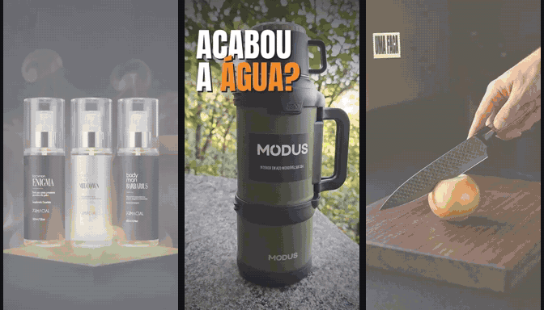
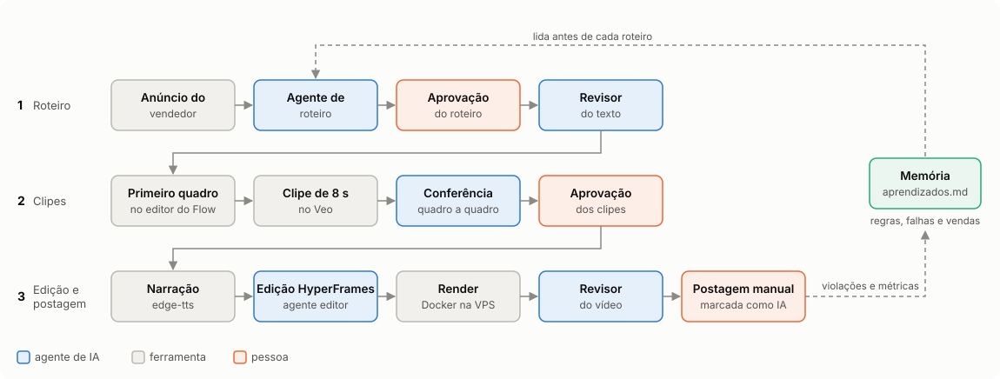
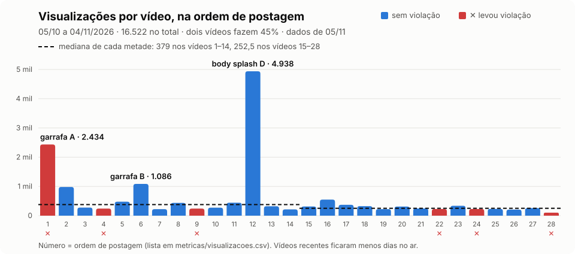
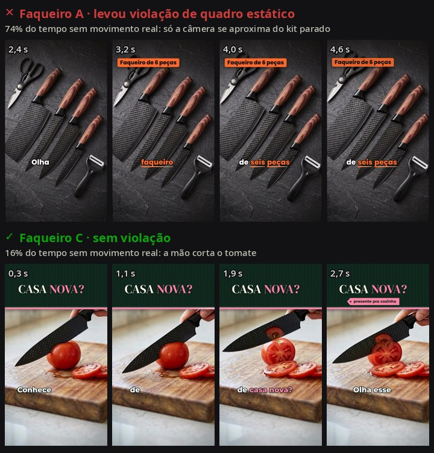
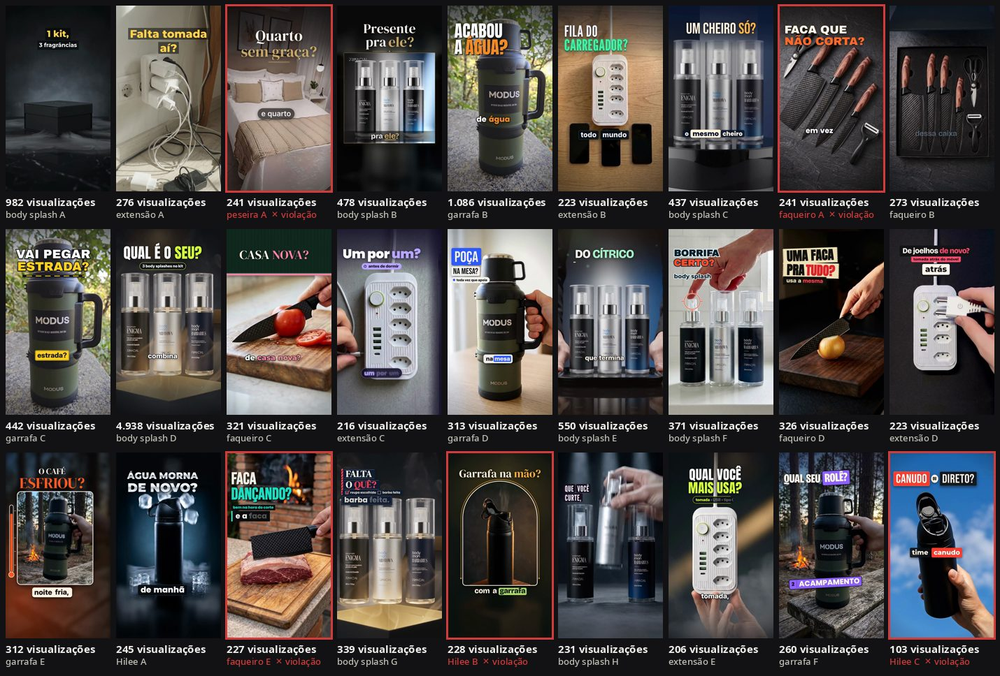

# Vídeos de afiliado com IA para o TikTok Shop

 

Um sistema que transforma o anúncio de um produto em vídeos verticais de propaganda, sem ninguém aparecer. Agentes de IA escrevem o roteiro, geram e conferem os clipes, narram e editam; uma pessoa aprova e publica. Rodou de verdade por um mês, numa conta real de afiliado.

  
   
  Três dos 28 vídeos postados: body splash D (4.938 visualizações), garrafa B (1.086) e faqueiro D (326).

| 28 vídeos | 16.522 visualizações | 2 vendas · R$ 290 | R$ 0 de API | 6 violações |
|:---:|:---:|:---:|:---:|:---:|
| 6 produtos, 05/10 a 04/11/2026 | mediana de 294 por vídeo | R$ 23,13 de comissão | só a assinatura do Google AI Plus | viraram regras, memória e um revisor |

https://github.com/user-attachments/assets/64dbc4ff-996c-47fd-8aa0-a745e9c75e9e

  Vídeo de apresentação (1 min 26 s), feito com o mesmo tipo de fluxo: roteiro escrito por um agente, narração edge-tts e cenas em HyperFrames e Remotion. Código em <a href="apresentacao/"><code>apresentacao/</code></a>.

## Como funciona

  

1. **Roteiro:** o agente lê o anúncio e escreve 9 partes (3 ganchos, 3 apresentações, 3 chamadas), que se combinam em vídeos diferentes sem repetir. O banco PostgreSQL guarda as combinações já usadas.
2. **Clipes:** o primeiro quadro é montado no editor de imagem do Flow a partir da foto do anúncio e conferido antes de gastar crédito. Só depois o Veo gera 8 s de vídeo a partir dele, com uma mão movendo o produto.
3. **Conferência:** cada clipe é olhado quadro a quadro (cor, formato, logotipo, contagem de peças). Clipe com qualquer diferença do produto é rejeitado.
4. **Edição:** o agente editor escreve uma composição HTML com animações (HyperFrames + GSAP), sincronizada palavra por palavra com a narração. Cada vídeo tem identidade visual própria. O render roda num container Docker na VPS.
5. **Revisor:** antes de gastar crédito e antes de postar, `revisor/revisar.py` confere o texto contra o anúncio e mede o movimento real do vídeo.
6. **Publicação:** sempre feita por uma pessoa, com o produto marcado e o aviso "Conteúdo gerado por IA".

## Como usei IA para construir

O projeto é operado por uma sessão do **Claude Code**, que coordena tudo e controla o Google Flow pelo navegador (Claude in Chrome). O trabalho especializado fica com três agentes, definidos em `.claude/agents/`:

| Agente | Faz | Recebe |
|---|---|---|
| `especialista-promocao` | Roteiro, ângulo de venda e prompts do Flow | Anúncio, regras e a memória do projeto |
| `editor-video` | A composição HyperFrames de cada vídeo | Roteiro, clipes e o tempo de cada palavra da narração |
| `revisor-conformidade` | Confere cada frase contra o anúncio | Anúncio, roteiro e legenda (sem a memória, para não "colar") |

- **Memória:** `produtos/aprendizados.md` registra cada falha do Flow, cada violação e o que vendeu. O agente de roteiro lê esse arquivo antes de cada roteiro. São 58 registros, a maioria com data e produto.
- **Regras fixas:** `CLAUDE.md` guarda o que não muda (só fatos do anúncio, produto em movimento em todo clipe, nada de postar sem uma pessoa).
- **A primeira versão era outra:** um bot do Telegram no n8n, com o Gemini escrevendo o roteiro (`n8n/`). Ele foi desligado em 08/10, quando a sessão do Claude Code passou a coordenar o ciclo inteiro, inclusive operar o Flow e conferir os clipes, coisa que o bot não fazia.

## Resultados

  

**Funil de outubro** (painel de afiliado):

| Impressões do produto | Cliques | Vendas | GMV | Comissão (até 05/11) |
|---:|---:|---:|---:|---:|
| 17.800 | 135 (0,76%) | 2 (1,5% dos cliques) | R$ 290,06 | R$ 23,13 |

**Por produto:**

| Produto | Vídeos | Visualizações | Mediana por vídeo |
|---|---:|---:|---:|
| Kit de body splash | 8 | 8.326 | 458 |
| Garrafa térmica MODUS | 6 | 4.847 | 378 |
| Faqueiro 6 peças | 5 | 1.388 | 273 |
| Extensão com USB | 5 | 1.144 | 223 |
| Garrafa Hilee | 3 | 576 | 228 |
| Peseira de tricô | 1 | 241 | 241 |

O que os números dizem:

- **Dois vídeos fazem 45% das visualizações.** O body splash D tem cara de comercial: produto grande, fumaça e luz, uma pergunta curta no primeiro segundo. Essa receita foi documentada e reaplicada. A garrafa A abre com o problema (uma garrafa de água esquentando no painel do carro).
- **O produto pesa mais que o formato.** A extensão ficou em cerca de 220 visualizações por vídeo com qualquer receita, inclusive a cópia exata do vídeo de maior alcance. A decisão foi parar de gastar crédito nela.
- **O gargalo é o clique, não a compra.** Menos de 1% de quem vê o produto toca nele; de quem toca, 1,5% compra.
- **O retorno financeiro foi pequeno.** As duas vendas vieram de vídeos da primeira semana. Depois disso o alcance caiu (mediana de 379 nos vídeos 1 a 14 e 252,5 nos vídeos 15 a 28), ao mesmo tempo em que as violações se acumulavam. Os vídeos recentes também ficaram menos dias no ar, então a queda não tem uma causa única comprovada.

Dados completos em [`metricas/`](metricas/).

## O que deu errado

O TikTok aplicou 6 violações automáticas; nas cinco com horário de postagem registrado, a punição veio entre 4 e 6 minutos depois ([`metricas/violacoes.md`](metricas/violacoes.md)):

| Violação | Vezes | Causa | O que mudou |
|---|:---:|---|---|
| Produto inconsistente | 3 | Na peseira: cena com objetos que pareciam parte do produto e padrão do tecido diferente do anúncio. Na garrafa A, hipótese: o vídeo abre com uma garrafa de plástico comum, não a do anúncio. Na Hilee C, a causa ainda não foi analisada | Produto protagonista em todo quadro; clipe com qualquer diferença é rejeitado |
| Quadro estático | 2 | Produto parado com só a câmera se aproximando; quadros congelados na edição | Uma mão move o produto em todo clipe; nada parado por mais de 1 s |
| Alegação exagerada | 1 | O gancho mostrava um problema que o anúncio não prometia resolver | Fala e tela só repetem o vendedor; o recurso foi aceito e os pontos, devolvidos |

**O conflito central:** a receita que evitava a primeira violação era a que causava a segunda. Para o produto sair idêntico ao anúncio, os clipes usavam a foto como primeiro quadro e pediam ao Veo só movimento de câmera. Ficava fiel, mas parado, e o TikTok leu como "imagem estática". A saída foi montar o primeiro quadro fiel no editor de imagem e pedir ao vídeo uma ação real: uma mão levantando, abrindo ou usando o produto.

  

## Revisor de conformidade

Cada violação virou uma verificação automática. `python revisor/revisar.py <produto> <lote>` roda três camadas:

- **regras fixas** no texto: preço, urgência, promessa absoluta, dado sem fonte;
- **um agente de IA** que compara cada frase com o anúncio e aponta a troca segura;
- **uma medida de movimento real** no vídeo, por fluxo óptico, descontando o movimento de câmera.

Testado nos 27 vídeos postados, contra o que o TikTok de fato aplicou:

| Verificação | Pegou a violação | Alarmes nos outros 25 vídeos |
|---|---|---|
| Agente de IA (alegação exagerada) | 1 de 1 | 5 reprovados, 13 em atenção |
| Movimento (quadro estático) | 1 de 2 | 2 reprovados, 3 em atenção |
| Produto inconsistente | fora do escopo | — |

O agente pegou a alegação sem ter visto a análise dela, mas é mais rígido que o TikTok (a maioria dos alarmes aponta exageros reais que passaram). A medida de movimento não separa um dos dois casos. E o tipo de violação mais comum, produto inconsistente, é visual e ainda não é coberto: o primeiro vídeo postado depois do revisor (Hilee C) passou nas três verificações e levou exatamente essa violação. A leitura completa está em [`revisor/README.md`](revisor/README.md).

## O que eu faria diferente

1. **Conferir a fidelidade visual automaticamente desde o primeiro vídeo.** Metade das violações foi de produto inconsistente. O próximo passo do revisor é comparar quadros do vídeo com as fotos do anúncio usando um modelo de visão.
2. **Validar o produto antes de produzir em volume.** A extensão recebeu 5 vídeos e nenhum passou de 276 visualizações.
3. **Medir por vídeo desde o primeiro dia:** visualizações, cliques, vendas e tempo gasto. Hoje há o total do mês, mas não a venda de cada vídeo.
4. **Concentrar nos produtos que vendem** e variar a receita que funcionou, em vez de abrir produtos novos.

## Linha do tempo

| Data | O que aconteceu |
|---|---|
| 05/10 | Primeiro vídeo (garrafa A) e primeira violação, no mesmo dia |
| 06/10 | Primeira arquitetura: bot do Telegram no n8n + Gemini; serviço de narração e montagem em FastAPI na VPS |
| 08/10 | Bot desligado; o Claude Code passa a coordenar tudo e a edição muda para HyperFrames. Segunda violação (peseira) |
| 08–10/10 | Técnica do primeiro quadro: produto fiel na primeira tentativa |
| 12/10 | Terceira violação (quadro estático): toda cena passa a ter o produto em movimento |
| 14/10 | Body splash D: 4.938 visualizações, maior alcance da conta |
| 21/10 | Quarta violação (alegação exagerada); recurso aceito em 28/10 |
| 28/10 | Quinta violação (quadro estático): mão movendo o produto em todo clipe |
| 03/11 | Teste de formato na extensão: o problema era o produto |
| 04/11 | Sexta violação (produto inconsistente, Hilee C) |
| 05/11 | Revisor de conformidade testado em todos os vídeos postados |

## Todos os vídeos

  

Os vídeos estão em `produtos/<produto>/video_<lote>.mp4` (720p). O vídeo A da garrafa não está no repositório.

## Estrutura

| Pasta | Conteúdo |
|---|---|
| `.github/workflows/` | Verificação automática a cada envio: testes do revisor, compilação dos scripts Python e tipos das cenas em Remotion |
| `.claude/agents/` | Os três agentes |
| `CLAUDE.md` | Regras fixas do projeto |
| `revisor/` | Revisor de conformidade (regras, agente de IA, movimento) e seus testes |
| `evals/` | Gabarito dos vídeos postados, executor dos testes e resultados |
| `metricas/` | Visualizações, vendas e violações |
| `produtos/<produto>/` | Anúncio, roteiros, análises dos clipes, edições e vídeos finais ([como ler](produtos/README.md)) |
| `render/` | Narração e montagem (FastAPI + ffmpeg) e o editor HyperFrames, em Docker |
| `db/` | Esquema do PostgreSQL |
| `docs/` | Especificação da arquitetura dos vídeos e imagens deste README |
| `n8n/` | Primeira versão: bot do Telegram com Gemini, desligada em 08/10 |
| `apresentacao/` | Vídeo de apresentação: roteiro, narração e cenas em HyperFrames e Remotion |

Instalação, API do render e configuração estão em [`LEIAME.md`](LEIAME.md). Fotos de referência, clipes brutos e capturas de tela ficaram fora do repositório.

O código está sob a [licença MIT](LICENSE). Marcas e produtos que aparecem nos vídeos e roteiros pertencem aos seus fabricantes.
